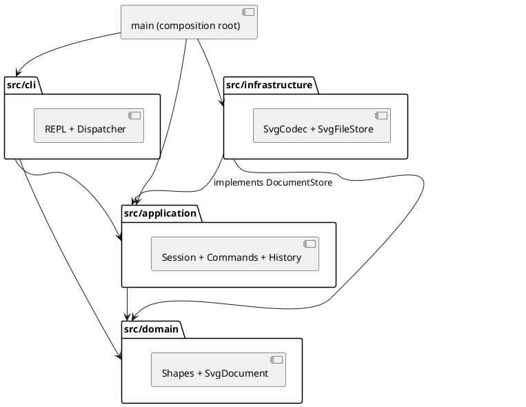
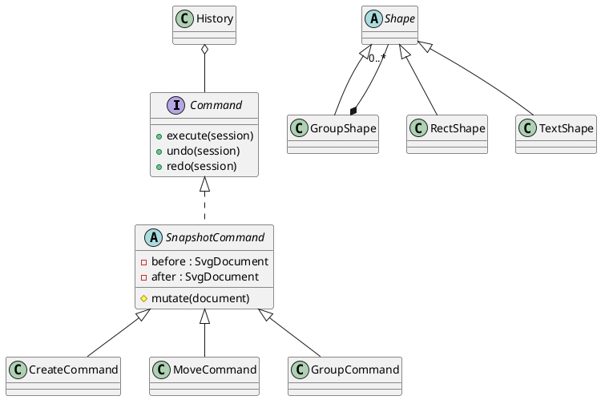

# 高级软件开发 Lab1 Phase 1：SVG 编辑器

## 架构方案

### 模块划分

| 模块 | 职责 |
| --- | --- |
| `src/domain/` | 封装图形、容器、几何校验、文档树与结构操作，不依赖 IO |
| `src/application/` | 编辑器会话、Command 命令、撤销重做、显示服务、存储端口 |
| `src/infrastructure/` | SVG XML 编解码、文件系统存储适配器 |
| `src/cli/` | 双引号词法分析、命令分发、REPL 输入输出 |
| `src/main.ts` | 唯一组装入口，连接具体依赖 |
| `test/`、`examples/` | 自动化验收与可回放案例 |



领域对象以私有字段封装状态：Shape 管理唯一 id、几何和样式；六个具体图形类自己负责构造、移动、克隆与摘要；SvgDocument 维护树结构操作。CLI 无法靠直接修改公共数组完成分组，children 返回只读的数组副本。应用接口中的 ReadResult 等仅作为 IO 数据传递结构，领域行为由图形及文档对象负责。

### 设计模式的选择

- **Command（必选）**：CreateCommand、MoveCommand、GroupCommand 等 10 个具体编辑命令类实现 SnapshotCommand 的 mutate；公共 execute / undo / redo 由基类实现。CommandDispatcher 创建命令、EditorSession 调用 History，领域对象作为 receiver。History 维护两个栈，只有 execute 成功才入栈、清空 redo。
- **Composite**：Shape 抽象统一叶子与 GroupShape；容器以多态递归执行 move / scale / clone，样式遵循 SVG 属性继承。
- **Memento**：编辑命令保留前后文档深拷贝；成功后提交，失败丢弃，避免半完成修改，确保撤销结构顺序与精确浮点值。
- **Factory**：ShapeFactory 是图形类型名到图形类的唯一分派点。
- **依赖倒置 / Adapter**：应用声明 DocumentStore，基础设施实现 SVG 文件读写；测试使用内存替身。



原子性流程：深拷贝编辑前文档 → 在候选副本执行 mutate → 完整成功后保存前后快照并替换当前文档 → History 入栈。若任何图形校验、成员查找、数值溢出失败，候选副本丢弃，不发布成功消息。撤销/重做恢复快照副本，不以浮点逆运算近似恢复。保存文件另用同目录临时文件与 rename，遵守已有文件的写权限并保留权限位。

### 依赖方向规则

domain 不得导入其他模块或 Node/XML 库；application 只能依赖 domain 和本层；infrastructure 可依赖 application 的存储端口及 domain；cli 可以依赖 application/domain 和本层，REPL 允许使用 Node 标准输入输出库，但不允许文件 IO 或 XML 库；main 可以组装所有层。测试可访问所有层。通过 TypeScript AST 脚本检查全部源码 import。

仅允许两个按名称分派的注册点：CommandDispatcher（命令名）与 ShapeFactory（图形类型名）。它们是本阶段明确保留的待重构点，后续可改为插件注册；属性校验属于各图形类的属性描述表，不以 tag 分派。

### 变化点假设

1. 增加图形/box 插件：Shape 多态接口和集中 Factory 留入口；本阶段不做动态加载，create box 必须失败。
2. 增加 GUI/agent 通道：复用 application 命令与会话，不依赖 REPL。
3. 文件格式/存储替换：通过 DocumentStore 替换；SVG XML 仅存在于 infrastructure。
4. 撤销性能：当前采用全树快照，适合教学规模；大型文档可将命令内部替换为增量 memento，暂不增加复杂度。
5. 外部 SVG 的完整规范：当前只支持题目六种元素，遇到不能无损解释的内容明确报错，避免悄悄丢图。


## 结果

验收环境为 Node.js 24.11.0；锁文件固定实际依赖版本；全程使用 CPU，无需数据集、GPU 或 VLLM。

```bash
npm ci
npm run check
npm run demo
node dist/src/main.js < examples/all-commands.commands
```

最终结果：**71 项测试通过，0 失败，0 跳过**；TypeScript strict 编译与架构检查通过。完整自动化输出见 [verification.txt](verification.txt)；真实 CLI 输出见 [流程图回放](flowchart-transcript.txt) 与 [全部命令回放](all-commands-transcript.txt)。另用伪终端手动执行 init、create、move、undo、tree，确认交互提示符为 `svg> `，Ctrl-D 正常退出。

| 验收范围 | 证据 |
| --- | --- |
| 六种内置类型、浮点/负坐标、fill/stroke 省略、白名单属性 | editor.test.ts：构造/几何/样式/文本 |
| move/scale 统一递归、删除子树、分组/解组/addto/z-order | editor.test.ts：嵌套结构与顺序断言 |
| 单命令 undo、redo 分支失效、显示跳过、文档 IO 锁定 | editor.test.ts：历史行为与全部 IO 屏障 |
| 错误消息、失败不改状态与历史、溢出回滚 | editor.test.ts：24 类失败命令和中途溢出 |
| SVG 标准 XML、中文/空格/特殊字符、缺 id 防碰撞 | codec.test.ts：round-trip、警告及格式校验 |
| 嵌套变换、展示属性、未知类型及畸形 XML 拒绝 | codec.test.ts：外部输入与阶段边界 |
| 真实文件、含空格路径、记忆路径、保存失败、只读权限 | cli.test.ts：临时目录内 IO 与原字节断言 |
| REPL 出错继续执行、退出码、完整流程图脚本 | cli.test.ts：真实 Node 子进程验收 |
| 模块依赖、一类一文件、无 switch/自由函数分派 | check-architecture.mjs：TypeScript AST 全量检查 |

测试重点验证可观察结果和失败时不变量；快照只用来比对序列化前后状态，不模拟被测命令内部实现。
```

