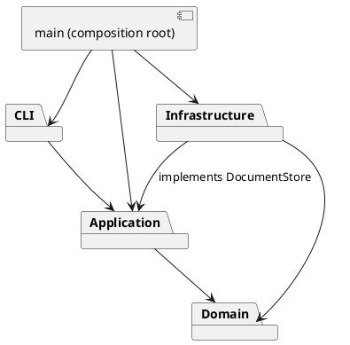

# 高级软件开发 Lab1 Phase 1：SVG 编辑器

## 架构方案

### 模块划分

| 模块 | 职责 |
| --- | --- |
| `src/domain/` | 封装图形、容器、几何校验、文档树与结构操作，不依赖 IO |
| `src/application/` | 编辑器会话、Command 命令、撤销重做、显示服务、存储端口 |
| `src/infrastructure/` | SVG XML 编解码、文件系统存储适配器 |
| `src/cli/` | 双引号词法分析、命令分发、REPL 输入输出 |
| `src/main.ts` | 唯一组装入口，连接具体依赖 |
| `test/`、`examples/` | 自动化验收与可回放案例 |

### 设计模式的选择

- **Command（必选）**：每条编辑指令一个命令类，具有 execute / undo / redo；History 维护两个栈。
- **Composite**：Shape 抽象统一叶子与 GroupShape；容器以多态递归执行 move / scale / clone，样式遵循 SVG 属性继承。
- **Memento**：编辑命令保留前后文档深拷贝；成功后提交，失败丢弃，避免半完成修改，确保撤销结构顺序与精确浮点值。
- **Factory**：ShapeFactory 是图形类型名到图形类的唯一分派点。
- **依赖倒置 / Adapter**：应用声明 DocumentStore，基础设施实现 SVG 文件读写；测试使用内存替身。

### 依赖方向规则

domain 不得导入其他模块或 Node/XML 库；application 只能依赖 domain 和本层；infrastructure 可依赖 application 的存储端口及 domain；cli 只能依赖 application/domain；main 可以组装所有层。测试可访问所有层。通过脚本抽查全部源码 import。

仅允许两个按名称分派的注册点：CommandDispatcher（命令名）与 ShapeFactory（图形类型名）。它们是本阶段明确保留的待重构点，后续可改为插件注册；属性校验属于各图形类的属性描述表，不以 tag 分派。

### 变化点假设

1. 增加图形/box 插件：Shape 多态接口和集中 Factory 留入口；本阶段不做动态加载，create box 必须失败。
2. 增加 GUI/agent 通道：复用 application 命令与会话，不依赖 REPL。
3. 文件格式/存储替换：通过 DocumentStore 替换；SVG XML 仅存在于 infrastructure。
4. 撤销性能：当前采用全树快照，适合教学规模；大型文档可将命令内部替换为增量 memento，暂不增加复杂度。
5. 外部 SVG 的完整规范：当前只支持题目六种元素，遇到不能无损解释的内容明确报错，避免悄悄丢图。

## 过程记录

- 初始检查：目录仅有题目，没有代码、Git 仓库及配置好的提交身份；先建立方案与工程骨架，再按领域、应用、IO、测试分步实现。提交作者使用本地自动化标识 `Codex <codex@local.invalid>`，不代表学生身份。
- 语义决策：root 下的 g 按题目规定禁止 ungroup；group 选中父与后代时整条失败；跨父级 group 采用文档深度优先顺序，挂在公共祖先中最早受影响的分支位置，避免依赖输入 id 的顺序。
- 语义决策：只有成功的文档 IO / canvas 改尺寸清空并锁定历史；显示、失败命令均不影响历史；下一条成功编辑解锁。

## 一致性自查

开发完成后记录实际检查结果。

## 质量保证手段

使用 TypeScript strict 编译、Node 内置测试、真实 CLI 回放、SVG 保存读回与依赖方向检查。完成后补充验收命令与实测结果。
